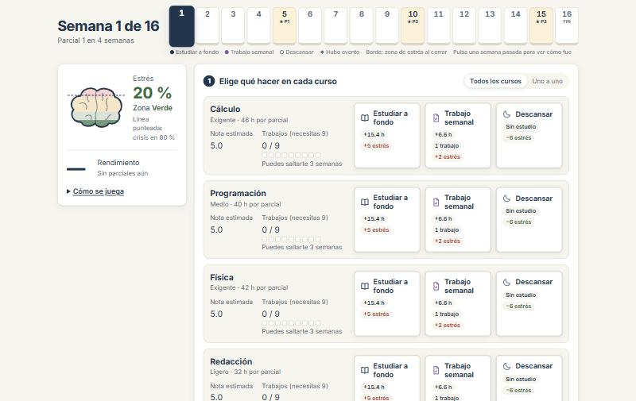
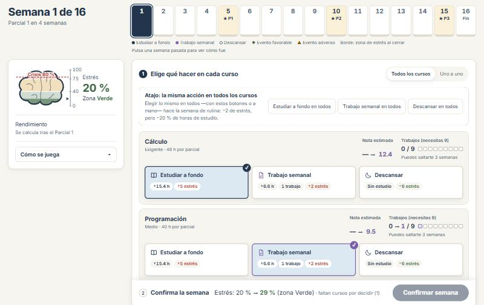
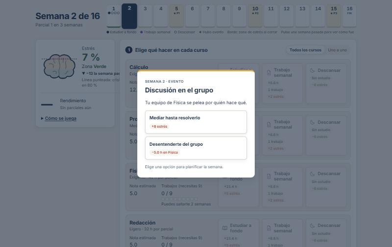
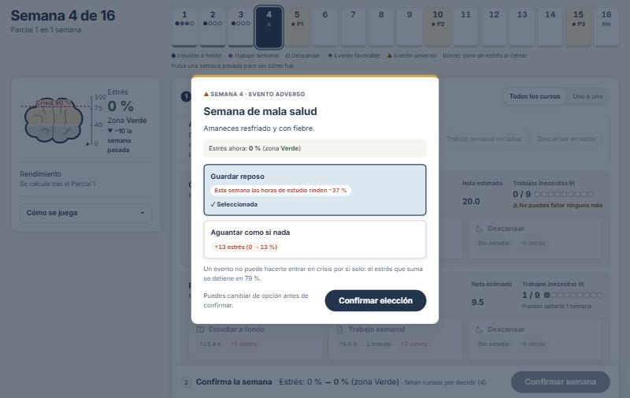
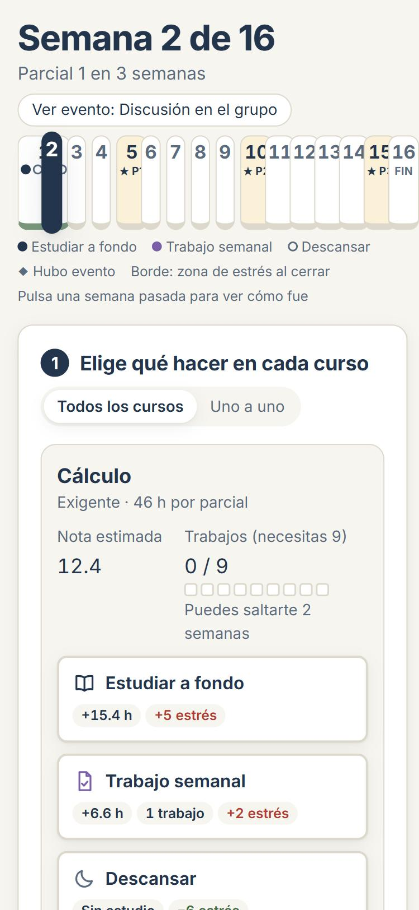
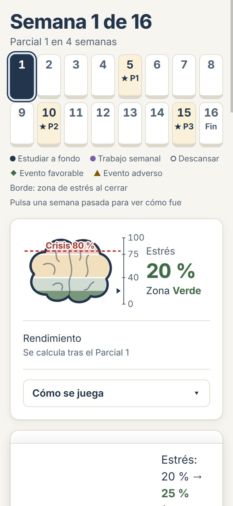
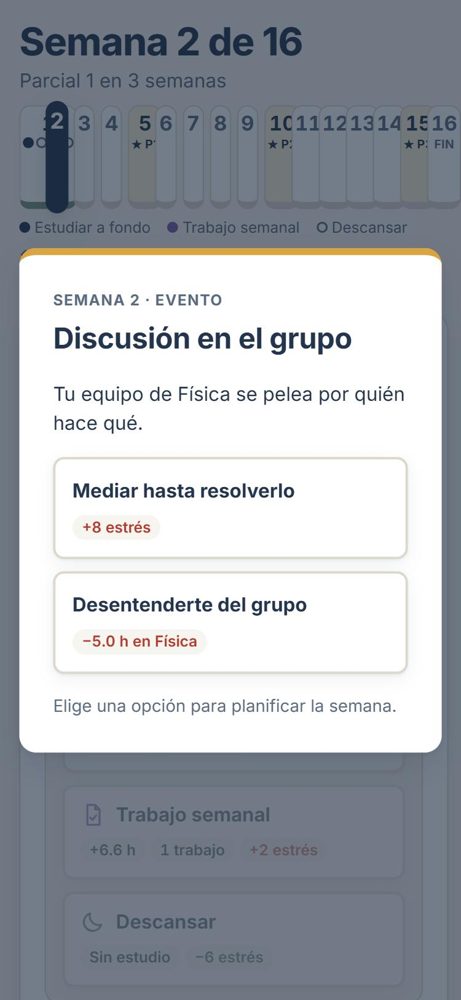
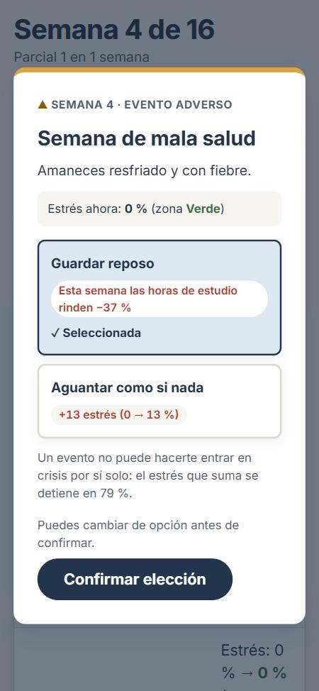
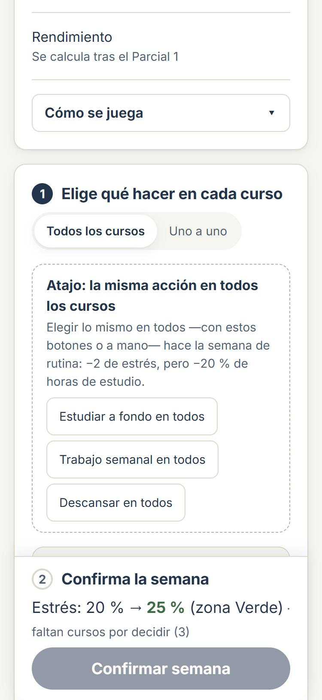

# UniversityLife — UI de la Fase 3: pantalla semanal y evento

Revisión visual y de experiencia de la pantalla semanal, sus sobrecapas (evento y crisis) y su coherencia con Inicio y Cierre. **No cambia ninguna regla:** no se tocaron `src/core`, `src/data` ni `src/store`, y los tests del núcleo y el bot de balance dan lo mismo que antes.

Complementa a [FASE-2.5-UI-UX.md](../FASE-2.5-UI-UX.md); los elementos validados de su §6 se conservan todos.

## 1. Inventario

| Elemento | Componente |
|---|---|
| Título de semana, cuenta atrás al parcial, acceso "Ver evento" | `Dashboard.tsx` |
| Calendario de 16 semanas y su leyenda | `Calendario.tsx` |
| Indicador de estrés con forma de cerebro | `BarraEstres.tsx` |
| Rendimiento y "Cómo se juega" | `PanelAlumno.tsx`, `ComoSeJuega.tsx` |
| Pasos numerados, selector de vista, atajo, fila de curso, nota estimada, trabajos, avisos, confirmación | `PanelDecision.tsx` |
| Card de acción con icono y efectos | `CardDecision.tsx` |
| "Qué pasó" y detalle de una semana pasada | `ResumenSemana.tsx` |
| Modal del evento | `ModalEvento.tsx` |
| Modal de crisis | `ModalCrisis.tsx` |
| Comportamiento de diálogo (foco, Escape) | `useDialogo.ts` (nuevo) |
| Textos visibles | `textos.ts` |
| Estilos y variables de diseño | `estilos.css` |

## 2. Cambios: problema → cambio → por qué

### Pantalla semanal

| Prioridad | Problema | Cambio | Por qué |
|---|---|---|---|
| P1 | El layout no llenaba el viewport y el panel de estado quedaba corto frente al central | Ancho máximo 1440 px, columna de estado de 340 px fija al hacer scroll (`position: sticky`) | La pantalla se ve compuesta y el estrés siempre está a la vista mientras se decide |
| P1 | Las tres cards eran lo más pequeño de la fila | Los datos del curso pasan a una franja encima y las cards ocupan todo el ancho | La decisión es lo principal; los datos la acompañan |
| P1 | Etiqueta, valor y pips de cada dato aparecían desconectados | Cada dato es un bloque: etiqueta, valor (con pips en la misma línea) y estado | Se lee de un vistazo |
| P2 | "Nota estimada 5.0" idéntica en todos los cursos sin horas | Con 0 horas se muestra "—" y "Sin horas en este tramo" | Un 5.0 sin estudiar parecía una nota real |
| P2 | "Rendimiento —" enorme parecía un error | Antes del Parcial 1: "Rendimiento · Se calcula tras el Parcial 1", en tamaño normal | Estado vacío explícito y sin protagonismo |
| P2 | Textos de 9.9 a 12.5 px | Variable `--t-min` de 13 px; ningún texto HTML por debajo, y los textos del cerebro rinden 13.9 px | Legibilidad |
| P3 | El cerebro no se leía y la crisis no tenía etiqueta | Cerebro de 190 px, bandas más marcadas, límites entre zonas, escala 0–40–75–100, aguja en la escala y "Crisis 80 %" sobre el propio gráfico | Se ve dónde está la crisis sin adivinar |
| P4 | "Cómo se juega" parecía un enlace | Botón con chevron que gira al abrir; el panel lateral tiene scroll propio si crece | Se descubre y no empuja nada fuera de vista |
| P4 | El atajo parecía el pie de la lista | Caja propia arriba de los cursos que explica qué es la rutina y cuándo se activa | El coste se lee antes de usarlo |
| P4 | La predicción de estrés solo se veía al final | Barra fija abajo con el paso 2, la predicción, los avisos y "Confirmar semana" | Se ve mientras se decide |
| P5 | Al cerrar la semana no se leía qué cambió | El valor de estrés destella al cambiar; "Qué pasó" solo en semanas con parcial, crisis, semana perdida o evento | Feedback sin ruido en semanas normales |
| P6 | Objetivos táctiles por debajo de 44 px | Variable `--objetivo-tactil` de 44 px en todos los botones | Accesibilidad |
| P6 | La semana actual se escalaba y pixelaba el texto | Color, borde y anillo; sin `scale` | Nitidez |
| P6 | El hover teñía todos los botones | El hover genérico solo marca el borde; cada componente decide su fondo | Menos ruido visual |
| — | En 375 px el calendario de 16 casillas se solapaba (no estaba en la lista) | Dos filas de 8 en pantallas estrechas | Era ilegible |
| — | A 1024 px el atajo y la barra se aplastaban | Responden al ancho del panel (container queries), no al de la ventana | Funciona en cualquier ancho intermedio |

### Evento de la semana

| Ref. | Problema | Cambio |
|---|---|---|
| EV1 | Un clic resolvía el evento | Elegir marca la opción ("✓ Seleccionada"); se puede cambiar; se aplica con "Confirmar elección". Un doble clic en confirmar resuelve un solo evento |
| EV2 | Se decidía sin contexto | El modal muestra el estrés y la zona actuales, el curso afectado y si es semana de parcial, y avisa de que un evento no puede provocar una crisis (el estrés se detiene en 79 %) |
| EV3 | Efectos en abstracto | Cada efecto dice qué cambia de verdad: "+13 estrés (0 → 13 %)", "+6.0 h en Física (tramo 0.0 → 6.0 de 42)", "+1 trabajo en Cálculo (ya tienes 9/9: no cambia nada para aprobar)". El resultado lo calcula `resolverEvento` del núcleo, sin duplicar reglas |
| EV3 | Dos textos distintos para el multiplicador de horas | Uno solo, "las horas de estudio rinden +X %", en el modal y en el aviso del panel |
| EV4 | Bueno y malo solo por color | "Evento favorable" con ◆ y "Evento adverso" con ▲, también en la leyenda del calendario; las opciones resueltas dicen "Lo que elegiste" y "Descartada" |
| EV5 | Poca huella del evento | Marca más grande en el calendario, que parpadea mientras el evento está pendiente; botón "Ver evento" con tipo y título; el aviso de horas nombra el evento; "Qué pasó" incluye el evento y lo elegido |
| EV6 | Accesibilidad del modal | Foco atrapado dentro, Escape cierra solo cuando ya está resuelto, y el foco vuelve al botón que lo abrió. El modal de crisis también atrapa el foco (sin Escape: hay que elegir) |

## 3. Variables nuevas en `estilos.css`

`--t-min`, `--borde-fuerte`, `--velo`, `--favorable-fondo`, `--espacio-s`, `--espacio-l`, `--radio-pildora`, `--objetivo-tactil`, `--anillo`, `--ancho-max` y `--ancho-lateral`. El tono `--tenue` se oscureció (de `#5a6b80` a `#4e5f75`) porque no llegaba a 4.5:1 sobre el fondo azul claro de las cards elegidas.

## 4. Contraste de los textos de zona

| Color | Sobre marfil | Sobre blanco |
|---|---|---|
| Verde `#3f6b45` | 5.66 | 6.18 |
| Amarillo `#8a5a00` | 5.44 | 5.93 |
| Rojo `#b23b30` | 5.41 | 5.90 |

Todos superan 4.5:1. Calculado con la fórmula de luminancia relativa de WCAG.

## 5. Tests

- Se actualizaron 6 tests de interfaz por el cambio de interacción del evento y de la nota estimada, sin quitar ninguna comprobación.
- Se añadieron 4: elección marcable y corregible con doble clic en confirmar, foco atrapado y Escape bloqueado sin resolver, efecto real con tope de estrés en 79 %, y trabajo de evento con contexto del curso.
- Siguen cubiertos: confirmar deshabilitado, doble clic en "Confirmar semana", bloqueo en crisis, confirmación de abandono y aviso de rutina.
- Total: 116 tests en verde, además de lint, tipos y build.

## 6. Verificación manual

- **1440 px:** cabecera, panel de estado fijo, cursos con cards a todo el ancho y barra de confirmación; sin desbordamiento horizontal.
- **1024 px:** atajo y barra apilados según el ancho del panel; sin desbordamiento.
- **375 px:** calendario en dos filas, vista "Uno a uno" por defecto, modal a ancho completo, barra apilada; sin desbordamiento.
- **Teclado:** en el evento, Enter marca una opción, Tab llega a "Confirmar elección" y Enter la aplica.

## 7. Capturas

| | Antes | Después |
|---|---|---|
| Semana, 1440 px |  |  |
| Evento, 1440 px |  |  |
| Semana, 375 px |  |  |
| Evento, 375 px |  |  |
| Decisión, 375 px | — |  |

La captura "después" de la semana a 1440 px se tomó antes de ensanchar la columna de estado de 320 a 340 px; el resto es la versión final.

## 8. Pendiente

- **Razones de la beca en el Cierre.** Necesita una función nueva en el núcleo que devuelva qué condiciones se cumplieron. Propuesta: `razonesBeca(estado): { condicion: string; cumplida: boolean }[]` en `src/core/simulacion.ts`. Espera confirmación.
- **Evolución del estrés en el Cierre.** Los datos ya están en el historial; falta diseñar el gráfico.
- **Inicio y Cierre** comparten variables y componentes con la pantalla semanal, pero no se rediseñaron en esta tanda.
- **Calendario a 1024 px:** cabe, pero las casillas quedan justas; una tira desplazable sería más cómoda.
- **Probar con jugadores** el paso de confirmación del evento: añade un clic por evento (unos 7 por partida).
